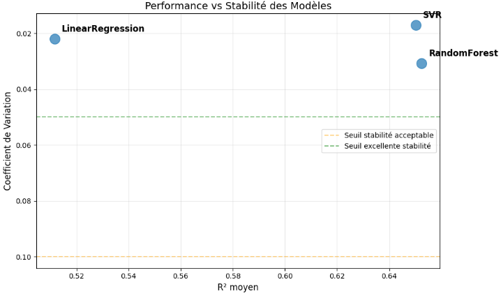
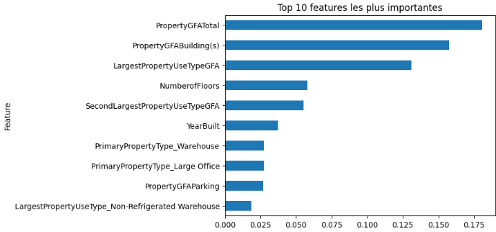
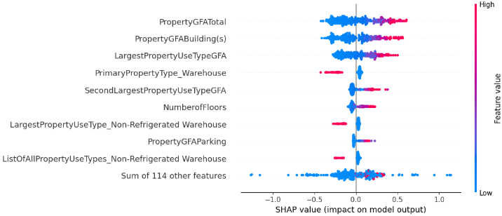
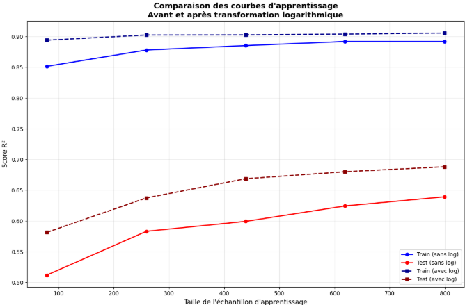
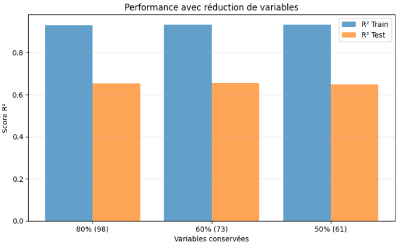

<!-- _class: lead -->
<!-- _paginate: false -->

# Prédiction de la Consommation Énergétique - Seattle

---

## Contexte du Projet

**Objectif :** Prédire la consommation énergétique des bâtiments de Seattle

**Données :** Dataset Building Energy Benchmarking 2016

- Variables architecturales (surface, étages, âge)
- Types d'usage (bureaux, entrepôts, commerces)
- Localisation

**Problématique :** Optimiser l'efficacité énergétique et identifier les facteurs clés de consommation

---

## Préparation des Données

- **Nettoyage et Preprocessing** :

  - **Prévention des fuites** : Suppression des variables contenant directement la réponse (EUI, kBtu, ENERGYSTARScore)
  - **Valeurs aberrantes** : Bornage au 1er %
  - **Variables catégorielles** : Regroupement des modalités rares (&lt;0.5%) en "Other"
  - **Transformation logarithmique** : Application sur la cible pour améliorer la distribution

---

## Métriques d’évaluation des modèles

- **RMSE** : racine de l’erreur quadratique moyenne. Pénalise fortement les grandes erreurs. Plus petit = meilleur.
- **MAE** : erreur absolue moyenne. Plus lisible, moins sensible aux valeurs extrêmes que le RMSE.
- **R²** : part de variance expliquée par le modèle (0 à 1, peut être négatif). Plus proche de 1 = meilleur.
- **CV** : dispersion relative (\(\sigma / \mu\)). Permet de comparer des données avec des échelles différentes.

---

## Démarche de Modélisation

 

**Comparaison d'Algorithmes** :

| Modèle            | R² Train (sans log) | R² Test (sans log) | R² Train (avec log) | R² Test (avec log) |
| ----------------- | ------------------- | ------------------ | ------------------- | ------------------ |
| Dummy             | -0.00               | -0.00              | -0.00               | -0.00              |
| Linear Regression | 0.72                | 0.58               | 0.66                | 0.51               |
| **Random Forest** | **0.95**            | **0.62**           | **0.95**            | **0.652**          |
| SVR               | -0.15               | -0.17              | 0.76                | 0.650              |

---

## Comparaison d'Algorithmes

  

---

**Analyse comparative :**

Bien que le modèle SVR présente une meilleure stabilité, nous retenons le **RandomForest** pour la suite de l'analyse pour les raisons suivantes :

- **Performance supérieure** : Le RandomForest affiche un R² plus élevé que le SVR
- **Stabilité acceptable** : Le coefficient de variation du RandomForest reste dans une plage acceptable, garantissant une fiabilité suffisante
- **Interprétabilité** : Le RandomForest offre des feature importance plus riches que le SVR

---

## Influence des Features sur le Modèle

 

  

---

## Analyse SHAP

**Beeswarm Plot** : Vue d'ensemble sur toutes les prédictions

- Confirmation : variables de surface dominent

  

---

## Conclusions

 

- **Cohérence du modèle** : Les variables de surface dominent logiquement les prédictions de consommation énergétique
- **Variabilité importante** : Même à surface égale, les consommations peuvent varier significativement (efficacité, usage, isolation...)
- **Validation** : Les résultats SHAP confirment l'importance des variables identifiées par le Random Forest

---

## Courbes d'Apprentissage

  

---

## Réduction des variables

  

---

## Réduction des variables

 

**Maintien des performances :** Même en ne conservant que 50% des variables les plus importantes, le modèle maintient des performances très satisfaisantes, avec une dégradation minimale du score R². Cette stabilité démontre que de nombreuses variables du dataset ont un impact minime sur la prédiction.

---

## Améliorations Possibles

1. **Engineering des features** :

   - Ratio surface/étages
   - Interaction entre type et surface

2. **Algorithmes avancés** :

   - XGBoost, LightGBM pour performances supérieures

---

## Déploiement

 

- Modèle simplifié avec 60% ou 50% des variables les plus importantes
- Pipeline automatisé de préprocessing
- Monitoring des performances en production
